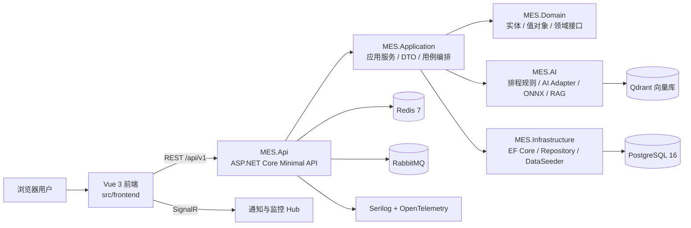
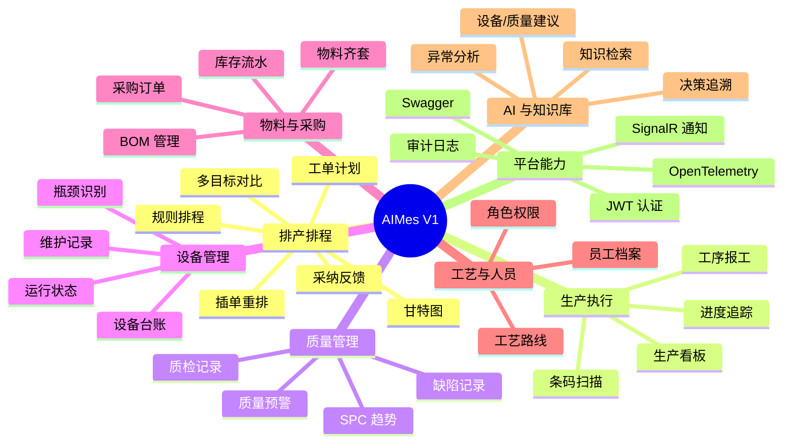

# AIMes V1

> 面向离散制造现场的智能 MES 原型系统：以排产排程为核心，连接生产、质量、设备、库存、采购、人员、知识库和 AI 决策追溯。

[](LICENSE)
[](https://dotnet.microsoft.com/)
[](https://vuejs.org/)
[](https://www.postgresql.org/)

## 项目背景

AIMes V1 是一个智能制造执行系统，用于验证“传统 MES + 规则排程 + AI 辅助决策”的完整产品形态。它不是单一看板，而是一套包含后端 API、前端操作台、数据持久化、实时通知、AI 服务接口、测试工程和 Docker 编排的端到端工程。

V1.5 当前主线是把 2026-05-19 以来的前端 AI 演示状态机逐步后端化。当前可复现量化口径（真实 .NET 跑出，无 PowerShell 硬编码）：在 `DEMO-OTD-30-202605` 30 单数据集、seed `20260523` 上，规则基线最佳策略（WeightedComposite）OTD `26.67%`，Agent 方案 OTD `30.00%`，改善 `+3.33` 个百分点（12.49% 相对改善），95% CI `[-19.46%, +26.12%]`，p-value `0.7745`——**30 单样本量下不显著（significantAt95: false）**，明确遵循 v3.0 路线图"不吹牛"原则。

报告由 `scripts/run-ab-comparison.ps1` 调用 `src/tools/MES.Tools.AbBenchmark` 真跑生成到 `src/frontend/public/reports/latest-ab-report.json` 和 `_docs/_reports/20260524-demo-otd-30-ab-report.md`。同 seed 重跑保持单次 A/B 结果一致，`generatedAt` 和 Monte Carlo 抽样摘要会刷新；当前 100 次扰动 Monte Carlo 均值为 `+7.67` 个百分点，95% CI `[6.92, 8.41]`。要让单次 +3.33 pts 真显著的下一步：把有效样本扩大到 1000+ 或接入 POC 现场数据，而不是把 demo 数据集包装成显著结论。

项目主要解决这些现场问题：

- 工单排产依赖人工经验，插单、设备故障、物料短缺后重排成本高。
- 质量、设备、库存、采购数据分散，异常发现慢，追溯链条不完整。
- AI 决策难以落地到 MES，因为缺少可审计的输入、输出、上下文和业务键。
- 工厂 IT 需要一个可本地运行、可演示、可二次开发的 MES 技术基座。

## 项目架构

仓库按后端、前端、测试、数据库脚本和文档拆分。当前解决方案文件位于后端目录：

```text
v1/
├── src/
│   ├── backend/
│   │   ├── AIMes.slnx
│   │   ├── MES.Api/
│   │   ├── MES.Application/
│   │   ├── MES.Domain/
│   │   ├── MES.Infrastructure/
│   │   └── MES.AI/
│   ├── frontend/
│   └── tests/
├── db/
├── _docs/
├── docker-compose.yml
└── Dockerfile
```

### 架构图



### 后端分层

| 项目 | 职责 |
|------|------|
| `MES.Api` | HTTP API、认证授权、Swagger、SignalR、健康检查、中间件 |
| `MES.Application` | 应用服务、DTO、业务用例编排、导出与看板服务 |
| `MES.Domain` | 领域实体、值对象、仓储接口、服务接口、领域事件 |
| `MES.Infrastructure` | EF Core、PostgreSQL 仓储、数据配置、集成服务 Stub、种子数据 |
| `MES.AI` | 排程规则引擎、重排策略、AI 分析 Adapter、ONNX/Qdrant/Semantic Kernel 服务 |

## 功能

### 功能架构图



### 核心模块

| 模块 | 说明 |
|------|------|
| 仪表盘 | 汇总生产、设备、质量、库存和排程关键指标 |
| 排产排程 | 工单优化、甘特图展示、瓶颈识别、多目标对比、拖拽调整 |
| 生产管理 | 工单、工序执行、报工、生产进度追踪 |
| 质量管理 | 检验记录、缺陷记录、SPC 展示、质量异常预警 |
| 设备管理 | 设备台账、状态监控、维护记录、设备健康评分 |
| 库存管理 | 物料库存、出入库流水、库存调整、齐套检查 |
| 采购管理 | 采购订单、供应商交付、采购状态流转 |
| BOM / 工艺路线 | 产品结构、BOM 版本、工艺步骤、工序参数 |
| 异常与风险 | 生产异常、风险看板、延期/设备/物料/产能风险 |
| 知识库 | 文档上传、知识查询、演示级 RAG 能力 |
| 系统管理 | 用户、配置、通知、审计日志 |
| AI 决策追溯 | 记录模型、prompt hash、context hash、输入输出摘要和业务键 |

## 用途

AIMes V1 适合这些场景：

- 智能 MES / APS / 工业 AI 产品原型验证。
- 制造业数字化项目的演示系统或售前样机。
- .NET + Vue + PostgreSQL 的复杂业务系统工程样板。
- 排程、质量、设备、库存、采购等模块的数据流和接口验证。
- AI 决策可追溯、RAG、ONNX 推理接口等工业 AI 能力的集成实验。

不建议直接作为生产 MES 使用。生产化需要补齐真实设备/ERP/WMS 集成、权限模型、数据治理、审计合规、部署高可用和安全加固。

## 技术栈

| 层 | 技术 |
|----|------|
| 后端 | .NET 10, ASP.NET Core Minimal API, SignalR, Swagger/OpenAPI |
| 前端 | Vue 3, TypeScript, Vite, Vue Router, dhtmlx-gantt, Axios |
| 数据库 | PostgreSQL 16, EF Core Migrations |
| 缓存 | Redis 7 |
| 消息 | RabbitMQ, MassTransit |
| AI / ML | Semantic Kernel, ONNX Runtime, Qdrant, 规则排程引擎 |
| 观测 | Serilog, OpenTelemetry Metrics/Tracing |
| 测试 | xUnit, FluentAssertions, Moq, Playwright, BenchmarkDotNet |
| 部署 | Docker Compose, multi-stage Dockerfile |

## 快速运行

### 前置条件

- Docker Desktop
- .NET SDK 10.0.x
- Node.js 20+ 或 22+
- PowerShell 7 或 Windows PowerShell

### Docker Compose 一键启动

```powershell
cd C:\AIWorks\AIMes\v1
docker compose up -d --build
```

启动后访问：

- 前端入口: `http://localhost:5000/scheduling/`
- API Swagger: `http://localhost:5000/swagger`
- 健康检查: `http://localhost:5000/health`

停止服务：

```powershell
docker compose down
```

清理数据库和中间件卷：

```powershell
docker compose down -v
```

### 本地开发运行

默认开发配置使用本机 SQL Server 2016：

| 项 | 值 |
|----|----|
| Provider | `SqlServer` |
| Server | `localhost` |
| Database | `mes_dev` |
| Login | `sa / zen` |

启动后端：

```powershell
cd C:\AIWorks\AIMes\v1
$env:ASPNETCORE_ENVIRONMENT = "Development"
dotnet run --project src/backend/MES.Api/MES.Api.csproj
```

如果要切回 Docker/PostgreSQL：

```powershell
cd C:\AIWorks\AIMes\v1
docker compose up -d postgresql redis rabbitmq qdrant
$env:ASPNETCORE_ENVIRONMENT = "Development"
$env:Database__Provider = "PostgreSQL"
$env:ConnectionStrings__DefaultConnection = "Host=localhost;Database=mes_dev;Username=postgres;Password=postgres"
dotnet run --project src/backend/MES.Api/MES.Api.csproj
```

启动前端开发服务器：

```powershell
cd C:\AIWorks\AIMes\v1\src\frontend
npm install
npm run dev
```

开发模式访问：

- 前端: `http://localhost:5173/scheduling/`
- 后端: `http://localhost:5147`

## 登录用户

演示账号由 `src/backend/MES.Infrastructure/Data/DataSeeder.cs` 写入数据库。

| 用户名 | 密码 | 角色 | 说明 |
|--------|------|------|------|
| `admin` | `admin123` | `Admin` | 管理员，可访问系统管理、审计日志等管理功能 |
| `operator1` | `admin123` | `Operator` | 操作员，可访问基础业务功能 |

这些账号仅用于本地演示。生产环境必须修改默认密码，并通过环境变量配置强随机 `Jwt__SigningKey`。

### V1.5 Agent 权限矩阵

调度员 Agent 的写入动作（采纳/拒绝排产方案、跨域执行包）受 `MES.Domain/Authorization/AgentPermissionPolicy` 集中管控，原则是"AI 能建议，但不能越权执行"。当前实现遵循 [`_docs/_design/20260524-v15-agent-permission-policy.md`](_docs/_design/20260524-v15-agent-permission-policy.md) 角色矩阵：

| 角色 | 排产采纳/拒绝 | 质量处置 | 采购动作 | 维护动作 |
|------|:---:|:---:|:---:|:---:|
| `Admin` | ✅ | ✅ | ✅ | ✅ |
| `Planner` | ✅ | ❌ | ❌ | ❌ |
| `Quality` | ❌ | ✅ | ❌ | ❌ |
| `Purchase` | ❌ | ❌ | ✅ | ❌ |
| `Maintenance` | ❌ | ❌ | ❌ | ✅ |
| `Operator` | ❌ | ❌ | ❌ | ❌ |

非授权角色调用对应 API 会得到 `403 Forbidden`，并在 `agent_action_results` 写入 `RejectedByPolicy` 行，在 `audit_logs` 写入 `AgentPolicyRejected` 行（含 `actor` / `role` / `business_key` / `trace_id` / `prompt_hash` / `context_hash`）。验收用例见 `MES.Tests.Unit.Authorization.AgentPermissionPolicyTests`（37 单元）和 `MES.Tests.Integration.Controllers.SchedulingControllerTests`（41 集成，含 5 角色 × 5 动作矩阵）。

## 预览与排查

`npm run preview` 只会启动前端预览服务，默认监听 `http://localhost:4173/scheduling/`，不会自动拉起后端。它依赖后端 API `http://localhost:5147`，所以如果没有先启动 `MES.Api`，登录和业务请求都会失败。

`npm run test:e2e` 会先构建前端，再用 Playwright 跑完整 E2E。它也是基于前端预览产物来执行，不是单独跑一个后端。

如果你在登录时看到 `Npgsql.NpgsqlException ... 127.0.0.1:5432`，说明当前后端还在走 PostgreSQL provider，但本机没有可用的 PostgreSQL 实例。切回本地 SQL Server 开发模式，或先启动 Docker/PostgreSQL，再登录：

```powershell
Remove-Item Env:Database__Provider -ErrorAction SilentlyContinue
Remove-Item Env:ConnectionStrings__DefaultConnection -ErrorAction SilentlyContinue
$env:ASPNETCORE_ENVIRONMENT = "Development"
dotnet run --project src/backend/MES.Api/MES.Api.csproj
```

如果你使用的是本地 SQL Server 2016，默认连接串是 `sa / zen`；如果后端能正常启动，`admin / admin123` 就可以登录。

## 常用命令

### 解决方案

```powershell
dotnet sln src/backend/AIMes.slnx list
dotnet restore src/backend/AIMes.slnx
dotnet build src/backend/AIMes.slnx
```

### 后端测试

```powershell
dotnet test src/tests/MES.Tests.Unit/MES.Tests.Unit.csproj
dotnet test src/tests/MES.Tests.Integration/MES.Tests.Integration.csproj
```

### 前端

```powershell
cd src/frontend
npm run build
npm run lint
npm run test:e2e
```

### 数据库迁移

```powershell
dotnet ef database update `
  --project src/backend/MES.Infrastructure `
  --startup-project src/backend/MES.Api
```

## API 入口

主要 API 前缀为 `/api/v1`：

| 路径 | 模块 |
|------|------|
| `/api/v1/auth` | 登录、登出、Token 撤销、密钥轮转 |
| `/api/v1/dashboard` | 首页看板 |
| `/api/v1/scheduling` | 排程计划、优化、重排、反馈 |
| `/api/v1/production` | 生产执行 |
| `/api/v1/quality` | 质量管理 |
| `/api/v1/equipment` | 设备管理 |
| `/api/v1/inventory` | 库存管理 |
| `/api/v1/purchase` | 采购管理 |
| `/api/v1/bom` | BOM |
| `/api/v1/routing` | 工艺路线 |
| `/api/v1/risk` | 风险看板 |
| `/api/v1/knowledge` | 知识库 |
| `/api/v1/admin` | 系统管理 |
| `/api/v1/audit-logs` | 审计日志 |
| `/hubs/notifications` | SignalR 通知 |
| `/hubs/monitoring` | SignalR 监控 |

## 配置说明

关键环境变量：

| 变量 | 说明 |
|------|------|
| `ASPNETCORE_ENVIRONMENT` | `Development` 或 `Production` |
| `ASPNETCORE_URLS` | API 监听地址，例如 `http://+:5000` |
| `Jwt__SigningKey` | JWT 签名密钥，生产必须配置强随机值 |
| `Database__Provider` | 数据库提供方：`SqlServer` 或 `PostgreSQL` |
| `ConnectionStrings__DefaultConnection` | SQL Server 或 PostgreSQL 连接串 |
| `ConnectionStrings__Redis` | Redis 连接串 |
| `ConnectionStrings__RabbitMQ` | RabbitMQ 连接串 |
| `Messaging__Transport` | 消息总线：开发可用 `Disabled`，生产使用 RabbitMQ |
| `AI__VectorStore__Provider` | 向量库 Provider，例如 `InMemory` 或 `Qdrant` |
| `Aimes__EnableSwagger` | Production 下显式启用 Swagger |
| `Aimes__DisableHttpsRedirect` | Docker 演示场景关闭 HTTPS 重定向 |

本地 `dotnet run` 默认读取 `src/backend/MES.Api/Properties/launchSettings.json`，HTTP 端口是 `5147`。前端 `npm run dev` 和 `npm run preview` 默认会把 `/api` 代理到 `http://localhost:5147`；如需连接 Docker Compose 暴露的 `5000`，可设置 `VITE_API_TARGET=http://localhost:5000` 后重启前端服务。

现有 EF 迁移文件按 PostgreSQL 生成。Development + SQL Server 路径使用 EF `EnsureCreated` 初始化本地演示库；正式迁移仍以 PostgreSQL 迁移为准。

## V1.5 深化功能

除核心 MES 功能外，V1.5 主线新增以下 AI 深化能力（点击查看详情）：

- **[能力目录](_docs/_capability/)**：OTD 量化基准、Agent 决策治理、质量知识链、异常事件中心、可执行助手等 15+ 模块
- **[Sprint 推进索引](_docs/_changelog/README.md)**：60+ 份 changelog 按 P0/P1/P2/P3 + 模块分类索引
- **[排产基准报告](_docs/_reports/20260524-demo-otd-30-ab-report.md)**：真实 .NET 跑出的 A/B 对比，含蒙特卡洛模拟、95% 置信区间与显著性检验
- **[权限矩阵](_docs/_design/20260524-v15-agent-permission-policy.md)**：5 角色 × 5 动作的 Agent 动作权限集中管控
- **[运行脚本](scripts/)**：`run-ab-comparison.ps1`（一键 OTD 对比）、`clean-nuxt.ps1`（Windows 构建锁清理）

## 文档

- [`CHANGELOG.md`](CHANGELOG.md): 面向用户的发布变更
- [`CONTRIBUTING.md`](CONTRIBUTING.md): 贡献方式、PR 要求和本地检查
- [`SECURITY.md`](SECURITY.md): 漏洞报告、安全响应和披露规则
- [`_docs/SOP.md`](_docs/SOP.md): 部署、备份、回滚和运维 SOP
- [`_docs/quickstart.md`](_docs/quickstart.md): 快速上手
- [`_docs/troubleshooting.md`](_docs/troubleshooting.md): 常见问题排查
- [`_docs/commercial-vs-opensource.md`](_docs/commercial-vs-opensource.md): 开源版与商业版边界
- [`_docs/_changelog/`](_docs/_changelog/): 内部开发记录

## 许可证

本项目使用 [Apache License 2.0](LICENSE)。
