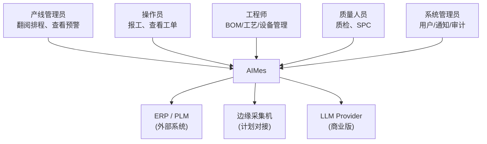
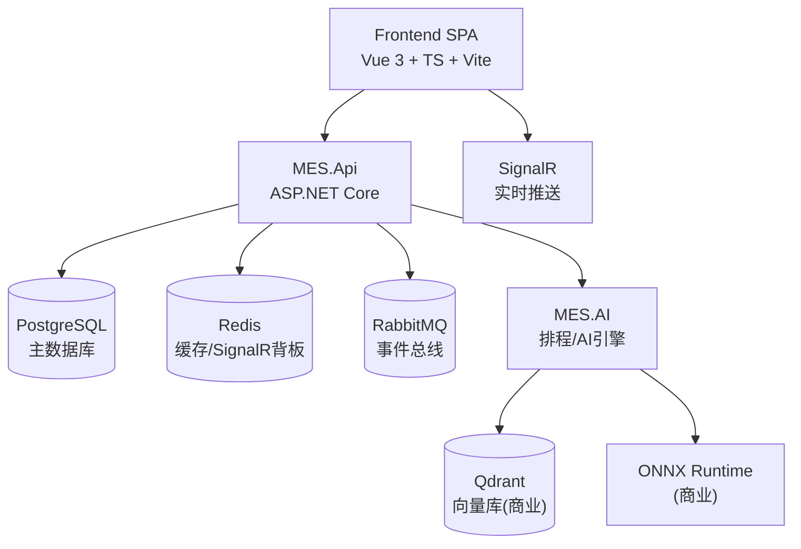
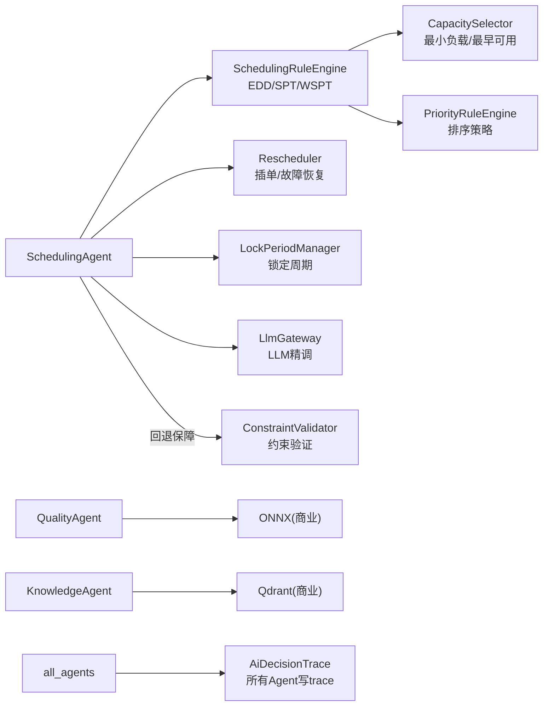

# AIMes V1 — 设计文档

> **版本**: v1.0 | **最后更新**: 2026-05-12
> **状态**: 已落地（P0–P3 完成，开源版 v0.1 功能边界已冻结）
> **关联**: [task.md](../../task.md) 是 v4.0 长期愿景，V1 是 Phase 1 + 部分 Phase 2 的开源 80% 切片

---

## 问题陈述

工厂的产线管理员每天都在"救火"：设备故障、采集机宕机、工单延期、物料跟不上。现有 MES 系统（包括我们之前的 iMES）只是"记账式"的——记录发生了什么，但不会帮助预防问题。系统被"忍受"但不被"依赖"。

## 需求证据

之前 iMES 在真实工厂有部署和使用。产品建模、排程、BOM 变更会直接影响生产——用户在这些场景下表现出真实焦虑。但整体上 iMES 的附加值低，工厂只是为了"有比没有强"而在用。

## 现状

工厂目前用 iMES 开源版做基础数据记录。排产靠人工经验+Excel，设备数据采集不稳定（采集机经常死机），异常靠人去巡检发现。产线管理员是最大的痛点角色——每天到处救火，没有系统帮他提前发现问题。

## 目标用户与最小切入点

**产线管理员（总线管理员）**——管理全部产线，是最忙、最痛的角色。最小切入点：让系统能提前告诉他哪里要出问题，而不是等他去发现。排产排程是核心价值，AI 算法驱动、自我学习是长期差异化。

---

## V1 已落地能力（P0–P3 完成）

V1 已经从设计辩论阶段进入可运行状态。以下能力已全部建成并通过测试：

| 层 | 能力 | 状态 |
|----|------|------|
| 排程引擎 | 规则引擎（EDD/SPT/WSPT + 最小负载 + 约束验证）+ 重排器（插单/故障/锁定）+ LLM 混合精调（v2.1.0-hybrid） | 已交付 |
| 排程甘特图 | dhtmlx-gantt 前端，设备分组、瓶颈高亮、冲突闪烁、拖拽调整 | 已交付 |
| 决策可追溯 | AiDecisionTrace（model/prompt hash + context hash + input/output summary + 业务键） | 已交付 |
| 实时通知 | SignalR + 6 类通知（设备/质量/生产/异常/库存/采购）+ 前端 Toast | 已交付 |
| 质量管理 | SPC 图、质检记录、规则告警 | 已交付 |
| 设备管理 | 状态跟踪、维护记录、健康分 | 已交付 |
| BOM/工艺路线 | 多级 BOM、工艺路线定义、变更管理 | 已交付 |
| 异常管理 | 上报、分级、响应流 | 已交付 |
| 库存/采购 | 库存台账、出入库、采购订单 | 已交付 |
| 人员管理 | 员工档案、岗位 | 已交付 |
| 知识库 | 文档上传+关键字检索+演示 RAG 问答 | 已交付 |
| 审计日志 | 操作追踪、JSON diff、IP/UA 记录 | 已交付 |
| 条码打印 | QR 码批量打印、筛选搜索 | 已交付 |
| 认证与授权 | JWT、4 角色（Operator/Lead/Engineer/Admin） | 已交付 |
| 部署 | Docker Compose（postgres/redis/rabbitmq/qdrant/api）+ GitHub Actions CI | 已交付 |
| 演示降级 | 所有看板内置"后端不可用 → 演示数据"分支 | 已交付 |
| 测试 | 152 单元测试 + 45 集成测试 + Playwright E2E + BenchmarkDotNet 性能基准 | 全部通过 |
| 采纳反馈 | ScheduleAdoptionFeedback 领域实体 + AdoptionFeedbackService | 已交付 |
| 认证安全 | Refresh Token 轮转 + 固定窗口速率限制 | 已交付 |
| 多目标优化 | IObjectiveFunction 接口 + 4 实现（DueDate/Utilization/Changeover/Balanced） | 已交付 |

---

## 前提

1. AI 排产排程是核心价值主张，开源版做到 80%（确定性规则引擎），商业版做完整 AI（LLM 精调 + 多目标 Pareto + 自学习）
2. 必须从"记账式 MES"升级到有预测和预防能力的系统
3. 开源版必须本身有足够价值，能吸引真实用户采用，不能是个空壳
4. **V1 不做插件架构**，只做模块边界（MES.AI 单体项目）；插件架构推迟到 v4.0

---

## 体系结构视图

### C4-Context（系统上下文）



### C4-Container（容器视图）



### C4-Component（MES.AI 组件）



---

## 排程引擎规约

### 输入合约

```
ScheduleRequest {
    WorkshopId: string
    Orders: WorkOrderInfo[]        // { Id, OrderNumber, ProductCode, Quantity, DueDate, Priority, RouteCode }
    Equipment: EquipmentCapacity[] // { Id, Capacity, Type }
    Materials: Dictionary<string, int>
    Deadlines: Dictionary<string, DateTime>
    OptimizationObjective: "due_date" | "utilization" | "changeover" | "balanced"
    LockedOrderIds: string[]       // 锁定周期内不可调整
}
```

### 优化目标形式化

| 目标 | 定义 | 适用场景 |
|------|------|----------|
| `due_date` | minimize Σ max(0, EndTime − DueDate) × Weight | 交期压力大时 |
| `utilization` | maximize Σ(BusyMinutes/TotalMinutes) over bottleneck equipment | 产能瓶颈突出时 |
| `changeover` | minimize Σ Changeover(prevProduct→currProduct) | 频繁换型场景 |
| `balanced` | lexicographic: 先满足 due_date ≥ 95%, 再优化 utilization, 再优化 changeover | 默认均衡模式 |

### 混合架构契约（v2.1.0-hybrid）

```
规则引擎 (确定性) ──产初始解──> 约束验证 ──> LLM 精调 ──> 再验证
                                          │
                                    失败 ──┘──> 回退到规则引擎方案
```

- **规则引擎**是"可行解保证者"：EDD 排序 + 最小负载分配 + 瓶颈优先 + 换线感知
- **LLM**是"局部精调者"：在规则引擎初始解基础上优化设备选择和顺序
- **约束违规则强制回退**：LLM 输出不满足硬约束时，自动降级到规则引擎方案
- **所有输出写 AiDecisionTrace**：prompt hash + context hash + input/output summary

### 性能 SLO

| 场景 | 数据规模 | P95 响应时间 |
|------|----------|-------------|
| 常规排程 | 50 单 × 10 设备 × 7 天 | ≤ 2s |
| 大规模排程 | 200 单 × 30 设备 | ≤ 15s |
| 重排（插单） | 单次插单 | ≤ 500ms |

---

## 开源/商业功能边界（V1 冻结）

| 模块 | 开源版（MES.AI.Core） | 商业版增量（MES.AI.Pro） |
|------|----------------------|--------------------------|
| 排程 | 规则引擎（EDD/SPT/WSPT + 最小负载 + 约束验证）+ 重排器（插单/故障/锁定） | LLM 局部精调（v2.1.0-hybrid）+ 多目标 Pareto + 历史数据再训练 |
| 知识库 | 文档上传 + 关键字检索 + 演示问答 | RAG（Qdrant + Embedding + 多源）+ 对话记忆 + 引用溯源 |
| 质量 | SPC 图 + 规则告警 + 人工根因模板 | AI 视觉缺陷检测（ONNX）+ 根因 LLM 推断 + SPC 模式 LLM 识别 |
| 设备 | 状态/维护/健康分（规则） | 时序异常检测 + 故障预测 + 维护建议 LLM |
| 异常 | 人工上报 + 分级 + 响应流 | LLM 辅助诊断 + 相似案例向量检索 |
| 报表 | 静态聚合（SVG 自绘） | 自然语言 → SQL + 自动洞察 |
| 决策可追溯 | 写 trace，校验中间件已启用 | trace 反查面板 + 模型版本回滚 |

**物理分包决策**：将 `MES.AI` 拆分为 `MES.AI.Core`（规则引擎/重排/约束/Trace）和 `MES.AI.Pro`（LLM/Onnx/Qdrant/Agent），开源构建排除 `MES.AI.Pro` 引用。

---

## AI 决策可审计性（商业版护城河）

所有 Agent 输出强制遵守 4 项不变量：

1. **任何 Agent 输出必须写 trace**：`AiDecisionTrace` 值对象记录每次决策
2. **trace 必须可反查业务键**：工单号、设备号等业务标识必须写入 `RelatedBusinessKeys`
3. **prompt 内容哈希化保存**：不存明文 prompt，规避客户敏感数据泄露风险；存 SHA256 hash 用于事后验证
4. **模型版本变更必须记录**：`ModelVersion` 字段在切换模型时自动变更，开源版强制使用 `"deterministic-v1"`

现有 trace 覆盖的 Agent：SchedulingAgent, QualityAgent, KnowledgeAgent, MaintenanceAgent, AnomalyAgent, ProcessParameterAgent

---

## 部署矩阵

| 维度 | 开源/单机 | 开源/集群 | 商业/SaaS | 商业/私有 |
|------|-----------|-----------|-----------|-----------|
| Postgres | 单实例 | 主从 | 托管 | 客户提供 |
| Redis | 可选 | Sentinel | 托管 | 可选 |
| RabbitMQ | 可选 | 集群 | 托管 | 可选 |
| Qdrant | 关闭 | 单节点 | 托管 | 单节点 |
| LLM | 关闭 | 关闭 | Azure OpenAI / 自建 | 客户接入 / Ollama |
| Onnx 视觉 | 关闭 | 关闭 | GPU 节点池 | GPU 节点 |

---

## 安全模型

- **认证**: JWT（HS256），Access Token 8h 有效期
- **刷新**: Refresh Token 轮转模式（7d 有效期，每次使用 TryRemove + 重新生成，防重放）
- **速率限制**: 固定窗口限流器（认证端点 10 req/min，返回 429）
- **角色**: Operator（操作员）/ Lead（班组长）/ Engineer（工程师）/ Admin（管理员）
- **待补齐**: 密钥轮转策略、审计日志归档周期

---

## V2.0+ 路线规划（超出 V1 范围）

以下能力在 V1 中**不做**，标记为 v2.0+：

- 插件加载器 / Plugin Factory
- 多 Agent Orchestrator（当前为单体顺序调用）
- GPU 节点池 / 模型自学习闭环
- 边缘 Agent（Edge Agent）规范与实现
- 多租户 SaaS（DB 层 tenant_id 已设计，但完整隔离 v2.0+）
- 多目标 Pareto Top-3 方案选择

---

## 已决策事项

| # | 决策 | 结论 |
|---|------|------|
| A1 | MES.AI 拆分为 Core + Pro | **同意** — 物理分包锁定开源边界 |
| A2 | .NET 版本 | 以 net10.0 为准（已同步修订 CLAUDE.md 和 task.md） |
| A3 | 开源协议 | **Apache-2.0** |
| A4 | 边缘 Agent V1 范围 | 待定 — V1 不给实现，仅出规范文档 |
| A5 | 商业版 LLM Provider 默认 | **Ollama 本地化优先**（Azure OpenAI 为辅） |

---

## 成功标准

- 开源 6 个月后有 ≥3 家工厂真实部署试用
- 产线管理员能说出"AIMes 让我少跑车间了"
- 商业版 AI 排程有足够用户数据开始训练
- 排程准确度随时间明显提升

## 分发计划

- GitHub 开源（Apache-2.0）
- 官网 + 技术社区传播
- 文档全面：快速开始、架构说明、API 参考
